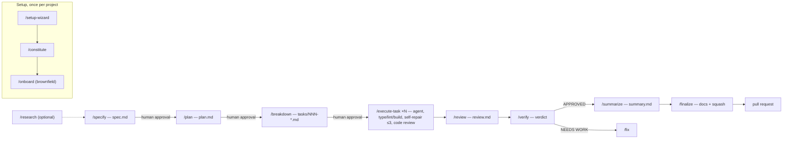
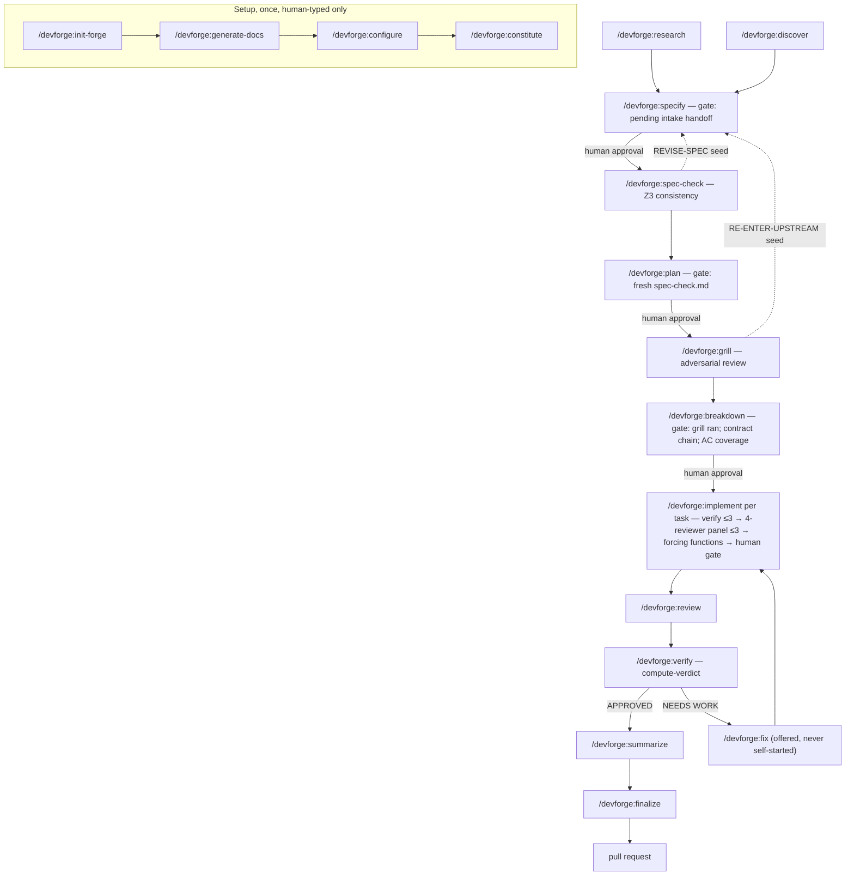

# Forge architecture brief — v1 (prose-driven) and v2 (code-governed)

**Date**: 2026-10-03
**Purpose**: source material for a presentation to a Solution Architecture Lead deciding on corporate adoption. Inventory, not argument: every statement below is backed by a file in this repository, a config or artifact in an installed copy, or a session transcript. Where the evidence is missing or contradictory the text says "not determined" or "discrepancy".
**Status**: working document, not a plan. Nothing here is ratified.
**Guard**: this file names no client, ticket ID, component, or filesystem path of a client installation. Client installs are labelled A–E and "benchmark install"; the maintainer holds the mapping separately. Private installs owned by the maintainer are named.
**Companions**: `research/2026-10-03-enterprise-gates-plain-language.md`, `research/2026-10-03-qa-queue-to-pipeline-verification.md`, `research/2026-10-03-vendor-lock-in-pitch-answer.md`, `research/2026-10-03-enterprise-adoption-evidence.md`, `RESEARCH-2026-09-27-V2-COST-DIAGNOSIS.md`.

---

## 0. Where each version lives

| | v1 | v2 |
|---|---|---|
| Git location | branch `main` (= `origin/main`), head `9eeff96` "Merge pull request #39"; an older cut on `release/v-1.23.0` | branch `develop-2.0-init` (= `origin/develop-2.0-init`), this checkout's working tree |
| Version marker | `.claude/template-version` = `1.28.0`; `CHANGELOG.md` `## [1.28.0] - 2026-04-10` | `src/manifest.json` `version` = `2.0.12`; `CHANGELOG.md` `## [2.0.0] - 2026-06-23` … `## [2.0.12] - 2026-09-20` + `## [Unreleased]` |
| Tags | none exist in the repository (`git tag` is empty) | none |
| Divergence point | `24a77b9` (PR #38, the v1 `/audit` command) is the merge-base of the two branches | 1,091 commits on the branch vs 137 on `main` |
| Shape | 62 tracked files: 19 command markdown files + 5 shared includes, 16 agent templates, `install.sh`, `update.sh`, `.mcp.json`; no Python, no tests | 914 tracked files plus untracked work in the tree (17 untracked plan files, `research/`); 21 command sources, 20 agents, ~120k lines of Python helpers, 237 test files with 12,091 test functions |
| Install footprint on this machine | 1.28.0 on client installs B, C (two workspaces) and on the maintainer's private `dosly`, `dosly-legacy`, `forgeV1`, `gamified-portfolio-tracker`; 1.27.0 on client install A and one benchmark copy | 2.0.12 on client install D, on the benchmark install, on private `Breakout-Port`; unstamped 2.0 on private `testForge20` and client install E |

**Discrepancy with the framing "v1 is in real work, v2 is in development".** Both halves are true but incomplete. v1 1.27–1.28 carries the production majority (three client workspaces, 32 research runs and 41 execute-task runs in September 2026 per `RESEARCH-2026-09-27-V2-COST-DIAGNOSIS.md` §3). v2 2.0.12 has also done real client work since 2026-09-25: one feature on client install D from `/devforge:research` through `/devforge:verify` (same file, F10, and the install's `specs/` directory). So v2 is "in development, with one real-work install, one benchmark install and one private end-to-end install", not "untested".

---

## 1. Purpose

Forge turns a feature request into merged code through a fixed sequence of artifacts (research report → spec → plan → tasks → per-task diffs → review → verdict → summary) produced by Claude Code and its subagents, with a human approval between each design stage and mechanical checks around each implementation step. The problem it addresses is the one every Fixed entry in v1's `CHANGELOG.md` records in some form: a coding agent left to prose instructions skips steps, loses the thread across a long run, over-reports what it verified, and runs destructive steps (squash, reset) before the preceding steps have actually completed. v1 (`README.md` on `main`, lines 1–12) answers that with hard gates, specialized agents and hooks written in prose; v2 keeps the same pipeline shape and moves the shape, state and gate decisions into Python helpers that the prose must call, so the orchestrator can no longer paraphrase or skip them.

---

## 2. v1 — the current working version (`main`, 1.28.0)

### 2.1 Components

**Orchestrator.** The Claude Code main session, reading one command file per invocation from `.claude/commands/<name>.md`. There is no code layer: every command is a markdown procedure, and the five `_`-prefixed includes (`_agent-assignment.md`, `_context-maintenance.md`, `_multi-task-continuation.md`, `_recovery.md`, `_tech-writer-onboarding.md`) are loaded by their parent commands on demand.

**Agents** (16 templates in `.claude/templates/agents/`, substituted into the consumer's `.claude/agents/` by `/setup-wizard`). Three model tiers, defined in `setup-wizard.md:211-215` and the `model:` line of each template; the README's defaults are Think = opus, Do = sonnet, Verify = sonnet, tech-writer always sonnet.

| Tier | Agents | Role | Reached from |
|---|---|---|---|
| Think | architect, api-designer, security-reviewer | design, contracts, security review | `/audit`, `/review`, `/security`, and the file-layer → agent table in `_agent-assignment.md` used by `/breakdown`, `/fix`, `/refactor` |
| Do | backend-, frontend-, mobile-, db-, devops-, migration-engineer, runtime-debugger, performance-analyst, design-auditor | write code per task; profile; debug | the task's `**Agent**` field, dispatched by `/execute-task` (`execute-task.md:192`); `/fix` uses runtime-debugger for diagnosis |
| Verify | code-reviewer, ac-verifier, qa-engineer | per-task code review; AC verification against the running app; test assessment | `/execute-task` PHASE 3.3, `/verify`, `/review` |
| fixed sonnet | tech-writer | docs after a feature; onboarding scan; doc refresh | `/finalize`, `/onboard`, `/refresh-docs` |

**Commands** (19). Setup: `setup-wizard`, `constitute`, `onboard`. Pipeline: `research` (optional), `specify`, `plan`, `breakdown`, `execute-task`, `review`, `verify`, `summarize`, `finalize`. Standalone: `fix`, `refactor`, `security`, `audit`, `report-bug`, `refresh-docs`. Maintainer-only: `release` (stripped at install, `install.sh:65`).

### 2.2 Flow from requirement to code

Every arrow is user-activated; 1.27.0 removed all auto-triggers (`CHANGELOG.md` `## [1.27.0]`, "All auto-triggers removed"). `/execute-task` takes `3`, `1-5` or `all` and drains tasks in dependency order with a Continue / Review / Pause prompt at each review checkpoint (`_multi-task-continuation.md:15-31`).

### 2.3 Where the human sits, how quality is controlled

Human stop points, as written in the command files: spec approval (`specify.md:220` "HARD GATE"), plan approval (`plan.md:247`), breakdown approval (`breakdown.md:264`), per-task code-review options when the reviewer returns REQUEST CHANGES or BLOCK (`execute-task.md:303-325`), STOP when the self-repair cap is exhausted (`execute-task.md:283`), the `/verify` batch bug-filing prompt (`verify.md:277`), the `/fix` and `/refactor` diagnosis gates, and the multi-task review checkpoints.

Quality mechanisms:

- **Type-check after every edit** — the only hook: `settings.template.json` `PostToolUse`, matcher `Edit|Write`, command `{{TYPE_CHECK_COMMAND}}`, `async: true`, 30 s timeout. Non-blocking; lint is not in it. The private `dosly` install shows it substituted as `dart analyze`.
- **Self-repair loop** — any failed check in PHASE 3.2 (type check, lint, build, done-conditions, contract postconditions, tests, wrapper isolation) relaunches a repair agent, at most 3 attempts, each committed as `repair attempt [M]/3`; on exhaustion the chain stops (`execute-task.md:252-287`).
- **Cross-task contracts** — each task declares Expects / Produces; Expects are checked before the agent runs and STOP on violation, Produces after (`execute-task.md:134-140, 257`).
- **Constitution** — `constitution.md` with `[universal]` sections copied verbatim and a pre-flight "violates any NON-NEGOTIABLE rule?" question; code-reviewer carries a constitution checklist.
- **Crash recovery** — an empty `[checkpoint]` commit and a `.claude/wip.md` marker before each task; `_recovery.md` offers resume / rollback+retry / rollback+skip / keep.
- **Audit anti-hallucination** — verbatim evidence quotes, re-read of cited files, exact-match consensus (`audit.md:196-220`); all done by the model, no script.

### 2.4 How agent behaviour is enforced, and where the prose approach breaks

Everything in 2.3 except the hook, the permissions allowlist, the `model:` frontmatter and `update.sh`'s placeholder check is prose: an instruction the model is asked to follow. The repository's own record of what that costs:

- **Lost threads.** 1.27.0: "the auto-verify trigger was buried in a dynamically-loaded sub-file … where the LLM lost the thread … squash executed (destructive) while docs and summary were dropped". 1.25.0: "Auto-verify sometimes skipped (instruction buried in external file)".
- **Context exhaustion.** 1.27.0: "monolithic verify launched up to 5 agents + squash + auto-summarize in a single command. Context filled before later phases could execute". The remedy was to split `/verify` into three commands and remove auto-chaining.
- **Instructions ignored.** 1.23.0: "Orchestrator skipping agent delegation for 'trivial' tasks despite clear instructions". 1.19.0: "Task 'Done When' checkboxes never checked" and "Spec AC checkboxes never checked".
- **Fabrication.** `audit.md:182` "adversarial mode invites hallucination"; `:347-348` "the agents are hallucinating evidence". 1.28.0 added the discard counters "so users can detect when agents drift toward fabrication".
- **Loops and partial failures.** 1.16.3 H6 "prevents infinite fix→review loops"; 1.25.0 "Recovery Phase 6 squash failure left unrecoverable WIP state"; 1.15.0 "agents were destroyed" by raw placeholders during update.
- **Guards that never fired.** The constitution guard in nine commands greps for the literal `_Run /constitute to populate_` (10 sites); the template writes it with backticks (`constitution.template.md:25`), so a fixed-string grep finds 0 hits. No command ever writes `Status: Approved`, yet `/plan` and `/breakdown` require it (`plan.md:23`, `breakdown.md:15-16`); approval lives only in the chat. The strictness question in `setup-wizard.md:190-195` is stored nowhere and read by nothing. `_recovery.md:69` checks for a "Squash Applied" marker no command writes.
- **Self-contradiction across files.** `README.md:187` says "never `git add -A`" while `execute-task.md:38`, `fix.md:38`, `refactor.md:40` run `git -C $SOURCE_ROOT add -A`; `storage-rules.md:168` says tech-writer runs after every task, `execute-task.md:412` says it does not; `README.md:228,252` attribute docs and squash to `/verify`, `finalize.md` does them. `QUALITY-AUDIT.md:22` records "C1 CRITICAL Phase 8 auto-compact impossible" for a feature 1.2.0 had announced.
- **Outcome evidence** — the frozen brownfield benchmark (`77-EVIDENCE-DISCOVERY-TO-LOCK-INVERSION.md`, untracked, identifiers private; summarized in `RESEARCH-2026-09-27-V2-COST-DIAGNOSIS.md` F8): all six v1 runs named the hidden second surface; one passed the probe per the narrative, zero per the report's table. The report's own sentence on the mechanism is "discovery-to-lock inversion", the design input for v2.

### 2.5 Environment and integration points

- **Runtime**: Claude Code with the Agent tool; git. `update.sh` hard-requires `jq` and `perl` and uses `git merge-file`; `install.sh` needs only bash. `npx` runs the two MCP servers.
- **MCP**: Context7 always (`.mcp.json`); Chrome DevTools only when AC verification is auto or browser-only (`setup-wizard.md:251-259`, port discovery in `scripts/chrome-devtools-mcp.sh`).
- **Install/update**: copies `.claude/`, `specs/`, `bugs/`, `research/`, `scripts/`, `.mcp.json`; manifest-driven update with overwrite / three-way merge (agents, CLAUDE.md, baselines in `.claude/.baseline/`) / union merge / copy-if-missing. `.claude/settings.json` is project-owned, so hook changes never reach installed projects.
- **Config**: `.claude/project-config.json` (31 keys), `CLAUDE.md` header fields, `.claude/template-version`.
- **Git**: `spec/NNN-short-desc` branches, `[checkpoint]` and `[WIP]` commits squashed at `/finalize` via `git merge-base`; wrapper mode (`install.sh --wrapper`) keeps the client repo free of framework files and commits there as `[TICKET-ID] - …`.

---

## 3. v2 — the version under development (`develop-2.0-init`, 2.0.12)

### 3.1 Components

**Orchestrator + command prose.** 21 command sources at `src/commands/<name>/main.md` with `references/`, emitted by `scripts/emitters/claude.py` (`_PROMOTED` tuple, line 57) to `.claude/commands/devforge/<name>.md` and invoked as `/devforge:<name>`. Four are human-typed only (`disable-model-invocation: true`): `init-forge`, `generate-docs`, `configure`, `constitute`. The rest are model-invocable: the model proposes the next command and runs it on an explicit yes (`src/CLAUDE.md` "Workflow").

**Helper layer (new).** One Python package per command under `src/devforge/lib/_<name>/` with a launcher `<name>_helper`, installed to `.devforge/lib/`. Helpers own: run state (`.devforge/<cmd>-state.json`, `specs/<feature>/*-state.json`), artifact rendering through typed setters, the `verify-*` gate verbs (exit 2 = blocked), typed JSON handoffs between stages (`research-handoff.json` → `handoff.json` → `plan-handoff.json` → `breakdown-handoff.json`, schemas in each package's `handoff_schema.py`), the verdict computation in `/devforge:verify` (`_verify/_cli.py` `compute-verdict`, "deterministic APPROVED / NEEDS WORK / REJECTED"), the self-repair and review-loop caps in `/devforge:implement` (`_implement/_cmds_verify.py` `SELF_REPAIR_CAP = 3`, `_cmds_review_loop.py` `REVIEW_LOOP_CAP = 3`), and the forcing-function detectors (`_constitute/_forcing_functions/`). Size: ~120k Python lines in `src/devforge/lib` + `scripts`, 237 test files, 12,091 `def test_` (counted 2026-10-03). The helpers import no model SDK (`research/2026-10-03-vendor-lock-in-pitch-answer.md` §7).

**Agents** (20 in `src/agents/`, generated by `scripts/generate-agents.py`, pruned per project by `/devforge:configure`). Four tiers via `model_tier:` frontmatter: think (architect, api-designer, devils-advocate, spec-formalizer), do (ten builders incl. the new `game-engineer`), verify (code-reviewer, qa-reviewer, ac-verifier, design-auditor, performance-analyst), security (security-reviewer). Reviewers are tools-locked read-only (`tools: Read, Grep, Glob, Bash`, no Edit/Write/Agent); spec-formalizer has no Bash. The framework pins no model: every agent ships `model: inherit`, and `/devforge:configure` writes the tier → model/effort mapping (`DEVELOPMENT-STATUS.md` decision 14).

**Runtime hooks** (`src/settings.template.json`, scripts in `src/hooks/`): `cbm-code-discovery-gate` (PreToolUse on Read|Grep|Glob, blocks the first raw call per session), `bash-ban-raw-tools` (PreToolUse on Bash, blocks the first raw grep/find/cat over source files), `cbm-mcp-marker` (PostToolUse, appends to `.devforge/cbm-usage.log`), `cbm-session-reminder` and `cbm-sync-session-start` (SessionStart). The v1 per-edit type-check hook is gone: verification runs at task boundaries (`src/CLAUDE.md` "Verification (explicit, scope-aware — no per-edit hooks)").

**External dependencies**: `codebase-memory-mcp` (code graph; required by `generate-docs`, `research`, `implement`), Context7, Chrome DevTools (conditional), `z3-solver` for `/devforge:spec-check` (pip, not installed by the framework), Python 3.8+, jq, Node (`README.md` "Requirements").

### 3.2 Flow with gates

### 3.3 Human checkpoints

| Stage | What the human decides | Mechanism |
|---|---|---|
| research / discover | six (eight) rubric answers, one per turn; cost gate; save + feature name + ticket | `AskUserQuestion`; helper records each answer (`set-*`), intake echo persisted (`record-intake-confirmation`) |
| specify | every decision point in 7 categories; approval at Phase 5 | one `AskUserQuestion` round per batch; `render-summary` block; a model-applied default must carry `--delegated-reply` |
| spec-check | disposition when the result is not clean (CONSISTENT auto-accepts) | user owns REVISE-SPEC / DISMISS; `/devforge:plan` reads presence + freshness only |
| plan | approval | `Approved` status written by the next command on invocation (`DEVELOPMENT-STATUS.md` decision 2) |
| grill | 4-way disposition PROCEED / REVISE-PLAN / RE-ENTER-UPSTREAM / KILL | user owns the verdict; `/devforge:breakdown` reads presence + adversary status only |
| breakdown | approval | same as plan |
| implement, per task | Stage A: each judgment call the panel made (one question each); Stage B: `approve` / `repair` / `skip` / `stop` after reading the diff | `src/commands/implement/main.md` PHASE 7; nothing commits before `approve`; no `all` or auto-approve form exists (plan 110 DECLINED 2026-10-03) |
| verify | batch bug filing on NEEDS WORK | PHASE 9 |
| fix | agree to the offered lane | proposal-only; never self-started |
| configure / constitute | Q9–Q13, per-section confirmation, forcing-function opt-ins, pre-commit hook opt-in | once per project |

Measured stops per run (medians, `RESEARCH-2026-09-27-V2-COST-DIAGNOSIS.md` F4): research 12, specify 2, plan 2, review 9, implement 75 (one run), configure 14, constitute 8. v1 for comparison: research 4, specify 1, plan 0, review 3, execute-task 6.

A rule that governs every checkpoint: a reply that picks none of the offered options ("you decide") is never recorded as the user's choice; the question is asked once more, then the command's named fallback applies (`src/CLAUDE.md` Never item 7). Recognizing such a reply is model judgment, not code.

### 3.4 Gates

| Gate | Where | Checks | On fail |
|---|---|---|---|
| Setup-chain preflight | `specify_helper preflight`, same shape in research/discover | `.devforge/init.yaml`, `docs/architecture.md`, `.devforge/configure.yaml`, `constitution.md` present and populated | exit 2, command refuses to run |
| Intake handoff | `specify_helper find-handoffs` | a pending `research-handoff.json` or `discover-handoff.json` in a feature dir | `/devforge:specify` blocks |
| Spec shape | `specify_helper verify-coverage`, `verify-ac-shape` (EARS regex per variant), `verify-ac-subsection-coverage`, `verify-mandatory-reads`, `rubric-coverage` + `dp-finalize` | every finding landed in AC / Constraint / OOS / Risk; AC statements well-formed; all 7 decision categories closed; mandatory reads done | exit 2 at Step 4.9 and the Phase 5 recheck; non-blocking siblings `verify-numerical-consistency`, `check-constitution-compliance`, `verify-change-kind-coherence` only report |
| Spec consistency | `/devforge:spec-check` (spec-formalizer agent, 2-pass quorum, Z3) | ACs do not contradict each other; each AC's subject resolves to code or a declared new behaviour | REVISE-SPEC / DISMISS put to the user; unresolved subjects block the clean verdict |
| Fresh spec-check | `plan_helper verify-spec-check` | `spec-check.md` exists and its recorded spec hash matches `spec.md` | exit 2, `/devforge:plan` BLOCKED, offers to run spec-check |
| Grill ran | `breakdown_helper verify-grill-ran` | `grill.md` exists and `grill-state.json` records a completed adversary run | exit 2, `/devforge:breakdown` BLOCKED |
| Breakdown integrity | `breakdown_helper verify-contract-chain`, `verify-ac-coverage`, `verify-property-coverage`, `verify-dead-code-coverage`, `verify-agent-roster`, `verify-manifest-present`, `finalize-handoff` | every Expects has a Produces; every AC has a task; plan-declared property-test targets and dead-code removals have tasks; assigned agents exist | hard halt before the approval gate |
| Research grounding | `research_helper verify-hypothesis-suppression`, check 8 (caller enumeration), `verify-findings` | a suppressed hypothesis is not the recommended approach in disguise; shared callers enumerated | exit 2; admissible exits are `record-gap` or `declare-grounded-overlap` |
| Per-task verify | `implement_helper verify-touched` | type-check + lint → build → tests for each touched package, cwd = source root, per-command ceiling `command_timeout`; wrapper isolation | `self_repair` up to 3 times (agent relaunched, no human); then `failed` exit 2 → Stage B offers only repair / skip / stop |
| Review panel | `implement_helper merge-review-panel` | four read-only reviewers all return their clean token | up to 3 rounds autonomously; then a `could-not-converge` item that cannot be approved as-is |
| Forcing functions | `implement_helper run-forcing-functions-gate` → `constitute_helper verify-magic-enum / verify-cross-layer-imports / verify-any-leak / verify-design-tokens` | the rules enabled in `.devforge/constitute.json` | exit 2, task gate-blocked; optional pre-commit hook `src/git-hooks/pre-commit-forcing-functions.sh` aborts the commit with exit 1 |
| Feature verdict | `verify_helper compute-verdict` with `regression-gate`, `check-dead-code-removal`, `check-hygiene`, AC results from ac-verifier | AC PASS/FAIL/PARTIAL table, assembled type/lint/build/test, review findings folded in | NEEDS WORK or REJECTED; a wiring contradiction on a user-facing surface is never PASS; APPROVED flips `spec.md` to Complete, which `/devforge:summarize` and `/devforge:finalize` require |
| Runtime hooks | `.claude/settings.json` | first raw Read/Grep/Glob and first raw grep/find/cat per session | exit 2 blocks that one call; later calls pass |
| Handoff schemas | `_<stage>/handoff_schema.py` (research, discover, specify, plan, breakdown) | typed fields and provenance on every stage-to-stage JSON | producer refuses to write; consumer refuses to read |
| Finding grounding | `_shared/_validate.py` `validate_findings`, called by `_audit`, `_grill`, `_review` | every finding's quoted evidence is re-read from the cited file | ungrounded findings are discarded and counted in the report's Methodology section |

### 3.5 What code controls now, and what stays prose

**Code decides**: whether a stage may start (preflights, presence + freshness gates), the shape of every artifact (setters, schemas, EARS regex), run state and crash recovery, the verdict in `/devforge:verify`, when a self-repair or review loop stops, panel aggregation, the forcing-function detectors, handoff validation, and which agents are installed. The orchestrator cannot extend a cap or write an artifact field the setter rejects.

**Prose still decides** (the repository says so explicitly): the content of findings and hypotheses; whether a surface shows the feature the user named ("identity evidence is model-cited and checked by nothing", `DEVELOPMENT-STATUS.md` decision 20); the recognition of a delegated reply (decision 19); the sweep steps marked "a SEARCH step no check enforces"; the reviewers' judgments inside the panel; every clarifying question's quality. `research/2026-10-03-vendor-lock-in-pitch-answer.md` §2 states the design choice: judgment phases are prose-driven for the ceiling and the iteration loop; the mechanical layer is code.

### 3.6 Configuration parameters that affect agent autonomy

Source: `src/devforge/lib/_configure/_schema.py` (`FIELD_SCHEMA`, `ENUM_FIELDS`, `FIELD_DEFAULTS`), written to `.devforge/configure.yaml` and rendered to `.devforge/project-config.json`.

| Key | Values | Effect | Read by |
|---|---|---|---|
| `workflow_enforcement` | Strict / Moderate / Light | **none on any gate** — read only by `/devforge:constitute`'s prose composition (`constitute/references/section-shapes.md`); the cost diagnosis L3 records "the knob the user answers today gates nothing" | `_configure/*`, `constitute` only. **Discrepancy**: a strictness setting that steers nothing, the same defect v1's unstored strictness question had |
| `ac_verification_mode` | code-only / tests / runtime-assisted / off | whether `ac-verifier` is installed and what it may use (code reading, tests, browser/API); `off` is the only mode where a wiring contradiction does not block APPROVED | `/devforge:configure` prune, `/devforge:verify` |
| `regression_gate` | full (default) / off | baseline-vs-head test comparison in `/devforge:verify`; `off` for suites that need compiled artifacts | `verify_helper regression-gate` |
| `e2e_command` | string, default empty | one advisory e2e run per feature in `/devforge:verify`; never changes the verdict | `/devforge:verify` |
| `require_ticket` | true / false (default) | "no ticket, no spec": intake refuses to allocate a feature dir without a ticket | `_research`, `_discover` feature allocation |
| `command_timeout` | seconds, default 120 | kill ceiling for each verify command; a timeout still enters self-repair | `_implement/_cmds_verify.py` |
| `claude_tier_think / do / verify / security`, `claude_effort_*` | model alias or pinned ID; default / low … max | which model and effort each tier runs on; `inherit` when unset; applied to agents and eight commands by `configure_helper apply-models` | `/devforge:configure` Q11, `update.sh` |
| `ai_attribution` | Yes / No | whether commits carry a Claude trailer | all commit-creating commands |
| `.devforge/constitute.json` `forcing_functions.<rule>.enabled` | true / false per rule (4 rules) | which detectors run at the implement gate and in the pre-commit hook | `run-forcing-functions-gate`, hook |
| `.claude/settings.json` `permissions.allow` | tool list | pre-approves Edit, Write, Bash, Agent, Web*, Task*, Context7 for the orchestrator | Claude Code |
| agent `tools:` frontmatter | per agent | reviewers and spec-formalizer cannot write; builders inherit all tools | Claude Code |
| `disable-model-invocation` | on 4 setup commands | the model may never start those four | emitter frontmatter |

Not configurable, by decision: an unattended `/devforge:implement` (plan 110 declined), the grill and spec-check gates (plans 129 and 128 are Phase 0 OPEN proposals to change that), the per-setter write cadence.

---

## 4. Status of v2, honestly

Status vocabulary: **done** = shipped and exercised on at least one consumer install; **in testing** = built and test-covered, exercised only on the benchmark or private installs, or flagged "Build-verified, NOT consumer-validated" in `DEVELOPMENT-STATUS.md`; **in progress** = plan open or build partial; **planned** = described in a plan or doc, no code.

| Component | Status | Evidence |
|---|---|---|
| Setup chain `init-forge` → `generate-docs` → `configure` → `constitute` | done | `src/commands/{init-forge,generate-docs,configure,constitute}/`; `_configure` 316 tests, `_constitute` 220, `tests/lib/test_generate_docs_helper.py`, `test_init_helper.py`; `.devforge/init.yaml` + `configure.yaml` + `constitute.json` present on client installs D, E, the benchmark and `testForge20` |
| `research` | done | `src/commands/research/main.md`, `tests/lib/test_research_helper.py` (+ `_research/` 30); `research-report.md` + `research-handoff.json` + `emission-matrix.md` on client install D and the benchmark |
| `discover` | in testing | `src/commands/discover/`, `tests/lib/test_discover_*.py` (7 files); no `discovery-report.md` found on any install on this machine |
| `specify` (+ in-place revision, design anchor) | done | `src/commands/specify/`, `_specify` 319 + `test_specify_helper.py`; `spec.md` + `handoff.json` + `design-anchor.json` on D and the benchmark |
| `spec-check` (Z3) | done | `src/commands/spec-check/`, `_spec_check` 504 tests; `spec-check.md` on D and the benchmark; needs `z3-solver` the installer does not install |
| `plan` | done | `src/commands/plan/`, `test_plan_helper.py`, `test_plan_handoff.py`; `plan.md` + `plan-handoff.json` on D and the benchmark |
| `grill` (devils-advocate) | done | `src/commands/grill/`, `_grill` 419 tests; `grill.md` + `grill-seed.json` (`cycle_count: 2`) on D and the benchmark — the re-entry loop ran twice on D |
| `breakdown` | done | `src/commands/breakdown/`, `test_breakdown_helper.py`; `breakdown-handoff.json` + 6 task files on D |
| `implement` (verify → panel → forcing functions → human gate) | done | `src/commands/implement/main.md`, `_implement` 747 tests; 3 tasks on D with 37 agent dispatches (research file F10); 2 tasks on `testForge20` with `scope-and-approve` recorded in Completion Notes |
| `review` | done | `src/commands/review/`, `_review` 364 tests; `review.md` + `review-state.json` on D and `testForge20`; `[WIP] review:` commits on D |
| `verify` (deterministic verdict, regression gate, hygiene) | done | `src/commands/verify/`, `_verify` 659 tests; `verification.md` + `verify-state.json` on D and `testForge20`; `[WIP] verify:` commits on D |
| `fix` (two lanes) | in testing | `src/commands/fix/`, `_fix` 117 tests; no commit whose subject contains "fix" in D's 21-commit log; the single `fix(...)` commit on `testForge20`'s install repo is the squashed feature commit, not a `/devforge:fix` run |
| `summarize` | done (private only) | `src/commands/summarize/`, `_summarize` 161; `summary.md` on `testForge20`; not yet on D |
| `finalize` | in testing | `src/commands/finalize/`, `_finalize` 168; `testForge20`'s install repo holds one squashed feature commit after the initial commit — whether `/devforge:finalize` produced it is not determined from the tree alone |
| `audit` (refutation stage, multi-pass) | done (private only) | `src/commands/audit/`, `_audit` 802; two reports in `testForge20/audits/` |
| `report-bug`, `report-ticket` | done (private only) | `_report_bug` 50, `_report_ticket` 45; `bugs/` on `testForge20` (3), D (1), `Breakout-Port` (3); `tickets/` on `Breakout-Port` |
| `pr-review` | **built, not emitted** | `src/commands/pr-review/`, `_pr_review` 1,084 tests, `pr_review_helper.py`; absent from `_PROMOTED` in `scripts/emitters/claude.py`; `04-PR-REVIEW-PLAN.md` "Queued behind … testForge20 manual verify"; not mentioned in `DEVELOPMENT-STATUS.md` |
| Forcing functions (4 detectors) + pre-commit hook | in testing | `_constitute/_forcing_functions/`, `tests/lib/test_verify_*_cmd.py`, `EMPIRICAL-VERIFY-MAGIC-ENUM-2026-05-21.md`; `testForge20`'s `constitute.json` has all three rules `enabled: false` — no install on this machine runs them |
| Design-fidelity mechanism (`_design`, anchor + manifest + runtime compare) | in testing | `40-DESIGN-FIDELITY-FORCING-FUNCTION-PLAN.md` "Phases 0–8 SHIPPED"; `_design` 245 tests; `design-anchor.json` on D and the benchmark; no `design-manifest.json` or compare run found |
| CBM runtime hooks | done | `src/hooks/*`, `tests/hooks/test_cbm_hooks.py`; `.devforge/cbm-usage.log` on every v2 install (747 lines on `testForge20`) |
| Typed handoffs, re-entry seeds | done | `_*/handoff_schema.py`, `_shared/seed_schema.py`; files present on D |
| Model/effort tiers, no framework defaults | in testing | plans 92/94; `DEVELOPMENT-STATUS.md` decision 14 "Build-verified, NOT consumer-validated"; `testForge20` config carries Opus/Sonnet/Haiku tiers |
| Scope rule, delegated-reply rule, intake provenance, surface-path proof (plans 98–109) | in testing | all labelled "Build-verified, NOT consumer-validated" in `DEVELOPMENT-STATUS.md` decisions 19–21 |
| `update.sh` / `install.sh` (three-way merge, repair guard, drift check, new-agent delivery) | done / in testing | `tests/scripts/test_post_update_checks.py`, `test_devforge_state_migrate.py`; new-agent delivery "Build-verified, NOT consumer-validated" |
| `profile_helper` (transcript profiler) | in progress | `_profile` 130 tests; maintainer-run only; its primary segmentation regex never matches real messages (research file F9); `.devforge/profile/` empty on every install |
| Memory-lane and agent-reachability gates | done (maintainer-side) | `tests/lib/test_memory_lane.py`, `test_agent_reachability.py`; `REGRESSION-ANCHORS.md` |
| Enterprise readiness: CI enforcement (57), audit trail (58), verdict reproducibility (59), gate governance (60), false-halt hardening + audited bypass (61) | **planned, no code** | each plan file reads `**Status:** SKELETON — NOT STARTED`; `ENTERPRISE-READINESS-ROADMAP.md`; the plain-language note in `research/` describes them as proposals |
| Unattended implement / auto-approve (110) | declined | `110-IMPLEMENT-AUTO-APPROVE-PLAN.md` "DECLINED 2026-10-03" |
| AC verification-command gate (128), grill gate → recommendation (129), cost reduction (124), CBM token measurement (127) | planned | all "Phase 0 OPEN — nothing built, nothing measured" |
| Open defects | in progress | `FINDINGS.md` lists 10 open findings with no owner (e.g. #7 `configure` renders the agent list before pruning; #8 `verify` can complete after bug filing failed; #9 a consumed re-entry seed is never retired) |

Two further caveats the status table cannot carry: the `breakdown` → `implement` field `Review checkpoint` is authored but read in no branch of `/devforge:implement` (`DEVELOPMENT-STATUS.md` decision 23), so every task stops; and the benchmark install's marker reads 2.0.12 today while the maintainer's record says it was frozen at 2.0.11 for the comparative runs — which build produced its artifacts is not determined here.

---

## 5. v1 → v2: what changed and why

| Aspect | v1 | v2 | v1 problem it addresses |
|---|---|---|---|
| Where the procedure lives | markdown only; the model is asked to follow it | markdown calls Python helpers that own state, shape and gates | lost threads, skipped steps, paraphrased gates (CHANGELOG 1.19.0, 1.23.0, 1.25.0, 1.27.0) |
| Stage preconditions | `Status: Approved` that nothing writes; sentinel grep that never matches | `preflight` / `verify-spec-check` / `verify-grill-ran` exit 2 with a BLOCKED message; status flipped by the next command on invocation | guards that fired never or always |
| Artifact shape | templates in prose; AC checkboxes "never checked" | setters with validators, EARS-shaped ACs, typed JSON handoffs with schemas | drift between files, unverifiable artifacts |
| Verdict | written by the orchestrator in the chat; report not saved | `compute-verdict` pure function; `verification.md` + `verify-state.json` committed | no persisted verdict history; argued verdicts |
| Per-task loop | one code reviewer; repair prose; "one repair, one re-review, STOP" | four read-only reviewers in parallel, ≤3 rounds, helper-owned counters; forcing-function detectors; two-stage human gate before any commit | infinite fix→review loops (1.16.3 H6); reviewer findings reported only to console |
| Verification timing | async type-check hook after every edit; lint not hooked | scope-aware type/lint/build/test at task end, per package, with a timeout ceiling | hook was non-blocking and project-owned (updates never reached it) |
| Intake | optional `/research` feasibility note | mandatory `/devforge:research` or `/devforge:discover` with rubric, hypotheses, caller enumeration, emission matrix | the "discovery-to-lock inversion" the v1 benchmark showed |
| Adversarial stages | none before implementation (`/audit` only after) | `/devforge:spec-check` (Z3) and `/devforge:grill` (devils-advocate), both required | a defective spec reaching implementation unchallenged; measured cost ≈1.5 h per feature (research file F5) |
| Code discovery | raw Read/Grep | codebase-memory-mcp graph, enforced by hooks | parallel buggy blocks missed (CHANGELOG 2.0.0 research redesign); cost: 72% of research context bytes now come from the graph (research file §2.1) |
| Setup | one 567-line `setup-wizard.md` | four commands + ~30k lines of Python; `configure` prunes agents, applies model tiers, excludes framework folders from linters | placeholders destroying agents (1.15.0); unreachable agents (1.23.0) |
| Model choice | fixed tiers opus/sonnet/sonnet | four tiers, no default, `inherit` unless configured | vendor-version coupling |
| Memory and state | `.claude/memory/MEMORY.md`, `.claude/session-state.md`, `.claude/wip.md` | `.devforge/memory.md` (section-aware excerpt), `.devforge/session-state.md`, `.devforge/wip.md` with a `Command` field | cross-command recovery confusion |
| Feature directories | `specs/NNN-slug/` | `specs/<YYYY>/<MM>/<ticket-or-slug>/`, allocated by intake; both shapes resolved | ticket provenance |
| Namespace | `/specify` etc. | `/devforge:<name>`; four human-typed only | collisions with bundled skills (plan 63) |
| Human stops per feature | research 4, specify 1, plan 0, execute-task 6 (medians) | research 12, specify 2, plan 2, implement 75 (one run) | — this is the cost side; see research file F4 |

**Not carried over.** `/setup-wizard` (replaced by the 4-command chain), `/onboard` (→ `/devforge:generate-docs`), `/execute-task` (→ `/devforge:implement`), `/refresh-docs` (closed OUTDATED, plan 28), `/refactor` (dropped, plan 21), `/security` (dropped; `/devforge:audit` runs the same agent), the per-edit PostToolUse hook, auto-triggers (already removed in 1.27.0), the `.claude/memory/` directory, the top-level `research/` and `discover/` directories (retired by plan 68; grandfathered as inert history).

**Reworked rather than ported.** `/fix` was dropped and reintroduced as a proposal-only gated command with two lanes; `/review` became a cross-task review without a verdict; `/verify` became the single verdict owner; `/finalize` squashes via `merge-base` as before but after an unconditional safety-net commit.

---

## 6. Data for metrics (inventory only)

### 6.1 In this repository

| Path | What it holds |
|---|---|
| `RESEARCH-2026-09-27-V2-COST-DIAGNOSIS.md` (untracked when this brief was written; committed 2026-11-07) | per-command wall-clock, turn counts, helper calls, stop counts, idle vs answering, token classes (output / cache-read / cache-write) for v1 (3 client installs, Aug 28–Sep 27, 92 sessions) and v2 (benchmark 15 sessions; client install D 3 sessions); tool-call and byte breakdown per command; model mix; the outcome table of the 20-run benchmark |
| `81-EVIDENCE-V2-BENCHMARK-RUN.md`, `77-EVIDENCE-DISCOVERY-TO-LOCK-INVERSION.md` (untracked, private identifiers) | the maintainer's verbatim benchmark reports for the v2 run and the v1 runs; causal chains; acceptance test for the re-run |
| `EMPIRICAL-VERIFY-MAGIC-ENUM-2026-05-21.md` | detector precision measurement that relaxed the magic-enum rule |
| `REGRESSION-ANCHORS.md` | the three framework regressions ever fixed, each pinned to a guard test |
| `FINDINGS.md`, `PLAN-STATUS-ARCHIVE.md`, `*-PLAN.md` (131 tracked + 17 untracked) | per-plan evidence class statements ("one observed instance", "nothing measured"), decision records with dates |
| `CHANGELOG.md` | v1 1.2.0 → 1.28.0 and v2 2.0.0 → 2.0.12 with the Fixed entries quoted in §2.4 |
| `research/2026-10-03-*.md` (4 files) | presentation prep: gates in plain language with CI cost estimates, QA-queue replacement with the metric list for a slide, vendor lock-in with measured line counts, published enterprise evidence |
| Obsidian vault `20 Projects/AIDevTeamForge/` | referenced by `CLAUDE.md` as the home of investigation rationale; **not found on this machine** under the home, Documents or iCloud paths searched — location not determined |

### 6.2 Session transcripts (the only source of tokens and time)

Claude Code writes one JSONL per session under `~/.claude/projects/<encoded-cwd>/` plus `<session>/subagents/*.jsonl`. Each assistant message carries `usage` (input, output, cache-read, cache-creation) and timestamps; v2 commands are identifiable by `/devforge:` markers and `*_helper` Bash calls, v1 commands only by the user's `<command-name>` marker. Counts on 2026-10-03 (main sessions / subagent transcripts):

| Install | Generation | Sessions |
|---|---|---|
| client install A (v1 1.27.0, 41 features) | v1 | 76 / 435 |
| client install B (v1 1.28.0, 48 features; two further workspace copies) | v1 | 37 / 237, plus 21 / 88 and 7 / 51 |
| client install C, backend and frontend workspaces (v1 1.28.0, 9 + 35 features) | v1 | 10 / 74 and 6 / 119 |
| benchmark install (v2) and its two v1 copies | v2 / v1 | 10 / 135; 1 / 14 and none |
| client install D (v2 2.0.12, 1 feature) | v2 | 6 / 156 |
| this repository (framework development) | — | 52 / 556 |
| `Breakout-Port` (v2, setup only) | v2 | 1 / 20 |
| `dosly`, `dosly-legacy`, `testForge20` | v1, v1, v2 | **none on this machine** — the artifacts exist, the transcripts do not |

Caveats recorded in the research file §1 and §4: subagent `usage` placeholders under-count output on a first pass; the profiler's command segmentation never fires on real messages (F9); v2 `breakdown` is not separable as a segment.

### 6.3 v1 run artifacts (per install)

Per feature under `specs/NNN-slug/`: `spec.md` (9 sections, AC checklist), `plan.md` (+ optional `research.md`, `data-model.md`, `contracts.md`), `tasks/NNN-*.md` with `Completion Notes` (`**Completed**` date, `**Files changed**`, `**Contract**: Expects X/Y | Produces X/Y`, `**Notes**`), `tasks/README.md` (dependency graph, review checkpoints), `review.md` (Security / Performance / Test Assessment, AC coverage matrix, overall verdict), `summary.md`. Per install: `research/YYYY-MM-DD-*.md` (63 on install B, 64 on A), `bugs/NNN-*.md` (86 on B, 21 on `dosly`), `audits/YYYY-MM-DD-audit.md` (3 on `dosly`), `.claude/memory/MEMORY.md`, `.claude/session-state.md`, git history with `spec/NNN-*` branches and squashed `feat(...)` commits.

What v1 does **not** log: tokens; durations (only a completion date, no start); repair-attempt counts outside WIP commit messages that the squash deletes; review rounds and per-task review verdicts (console only); the `/verify` verdict — `verify.md` on `main` never saves its report. **Discrepancy**: `verify.md` / `verification.md` files nonetheless exist in `dosly` (e.g. `specs/001-m3-theme/verify.md`: Acceptance Criteria, Code Quality, Review Findings, Issues Found, Overall Verdict) and in client installs A, B, C. Who wrote them — the model on its own, the user's request, or a template version other than the one on `main` — is not determined.

### 6.4 v2 run artifacts (per install)

Per feature under `specs/<YYYY>/<MM>/<leaf>/` or `specs/NNN-slug/`: `research-report.md`, `research-handoff.json`, `emission-matrix.md`, `probe-script.*`, `design-anchor.json`, `spec.md`, `handoff.json`, `spec-check.md` (Recommendation, "How your ACs were read as logic", Coverage), `plan.md`, `plan-handoff.json`, `grill.md` (Disposition, Confirmed findings, Methodology), `grill-state.json`, `grill-seed.json` (`cycle_count`, `carried_findings`, `must_satisfy`, `target_stage`), `breakdown-handoff.json`, `tasks/NNN-*.md` (same fields as v1 plus `**Review checkpoint**`, `**Spec criteria**`, and Completion Notes that record scoped verification), `review.md` + `review-state.json`, `verification.md` (Acceptance Criteria, Code Quality, Review Findings, Issues Found, Verdict) + `verify-state.json` (`phase`, `scope_files`, `status`, `verdict`), `summary.md`. Per install: `.devforge/cbm-usage.log` (one line per Bash and graph call), `.devforge/session-state.md`, `.devforge/memory.md`, `.devforge/spec-stamps.jsonl`, `.devforge/*-state.json`, `bugs/`, `tickets/`, `audits/`, and `[WIP] research/specify/review/verify:` commits that persist until `/devforge:finalize` squashes them. `.devforge/profile/` is empty on every install; the profiler has only been run from scratch locations.

### 6.5 v2 test runs, listed separately

| Run | Install | What exists |
|---|---|---|
| Frozen brownfield benchmark, 20 runs across 6 frameworks, one v2 run | benchmark install (client tree, read-only for this repo) | full pre-implement chain in one feature dir (research report, emission matrix, spec, spec-check, plan, grill with seed, handoffs, design anchor); no tasks; 10 / 135 transcripts; the maintainer's verbatim report in `81-EVIDENCE-V2-BENCHMARK-RUN.md`; the six v1 runs in the two sibling copies |
| One real feature end to end | client install D (2.0.12, wrapper mode) | every artifact in §6.4 through `verification.md`; 6 task files; grill ran twice (`cycle_count: 2`); 3 sessions, 156 subagent transcripts; measured in research file F10 |
| Private end-to-end test | `testForge20` (wrapper over a client monorepo; path held by the maintainer) | one feature with 2 tasks, `review.md`, `verification.md`, `summary.md`, handoffs and state files; 2 audit reports; 3 bugs; 747-line `cbm-usage.log`; predates the spec-check and grill gates (completed 2026-06-14) — no `spec-check.md` or `grill.md`; no transcripts |
| Research-only trial | client install E (unstamped 2.0) | one feature dir with `research-report.md` + `research-handoff.json` only |
| Setup-only trial | `Breakout-Port` (2.0.12, game project) | setup chain complete, `bugs/` and `tickets/`, no feature dirs |

---

## 7. Candidates for a harness example

The criterion was a complete trail: spec, agent logs, diff, gate results. Only client installs have agent transcripts on this machine, so the two real v1 candidates are described generically here; exact paths are with the maintainer.

1. **v1, real work — client install A, a 12-task feature** (1.27.0, wrapper mode). Trail: `spec.md`, `plan.md`, `tasks/` with 12 task files and `README.md`, `review.md`, `verification.md`, `summary.md`; 76 main-session and 435 subagent transcripts for the install (tokens, timings, every agent brief and reply); the squashed feature commit and, if not yet squashed elsewhere, `[WIP]` commits in the client repo. Gate results available: per-task `Contract X/Y` lines, review verdict, verification verdict. Limitation: a client codebase — identifiers cannot appear in public material.

2. **v1, real work — client install C frontend workspace, a 5-task feature** (1.28.0). Trail: `spec.md`, `research.md`, `plan.md`, 5 task files, `review.md`, `verification.md`, `summary.md`; 6 / 119 transcripts. Same limitation. A private alternative without transcripts: `dosly/specs/001-m3-theme/` (9 tasks, `research.md`, `review.md`, `verify.md`, `summary.md`, three audits in `dosly/audits/`, git history on `spec/NNN-*` branches) — complete artifacts and diff, no agent logs.

3. **v2, gate demonstration — client install D, the one real feature** (2.0.12). The only trail on this machine with every v2 gate exercised: research report and emission matrix, spec with design anchor, `spec-check.md`, plan, `grill.md` with RE-ENTER-UPSTREAM seeds that sent the chain back to specify twice (two grill runs, `cycle_count: 2`; the third pass went on to breakdown), breakdown handoff, 6 task files with Completion Notes, `review.md`, `verification.md` with the computed verdict, `[WIP] review:` / `[WIP] verify:` commits, 3 sessions with 156 subagent transcripts including the 37 agent dispatches of the implement run (research file F10). Limitation: client identifiers. A private alternative: the single feature directory under `testForge20/specs/` — complete through `summary.md` with a `scope-and-approve` verification note and two audit reports, but no spec-check, no grill, no transcripts.

For a demonstration that can be shown publicly, none of the three is usable as-is; the benchmark's acceptance re-run (`81-EVIDENCE-V2-BENCHMARK-RUN.md` "Acceptance test", model pinned, three or more runs) or a fresh run on `Breakout-Port` would produce a trail with no client identifiers.
